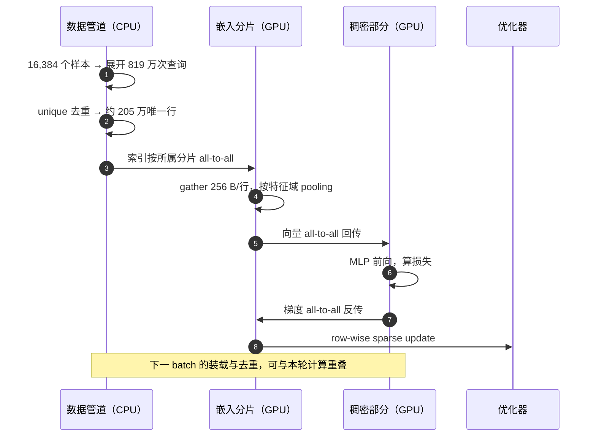
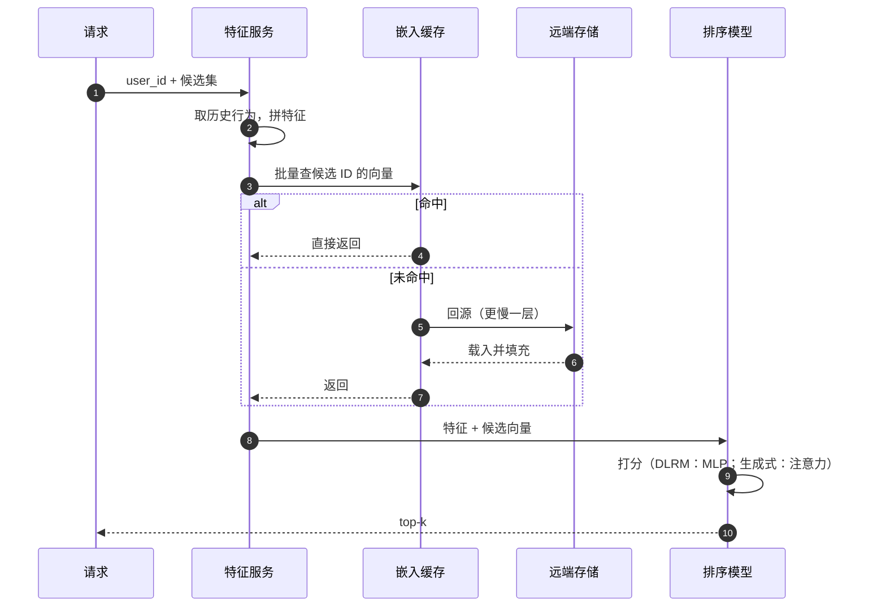
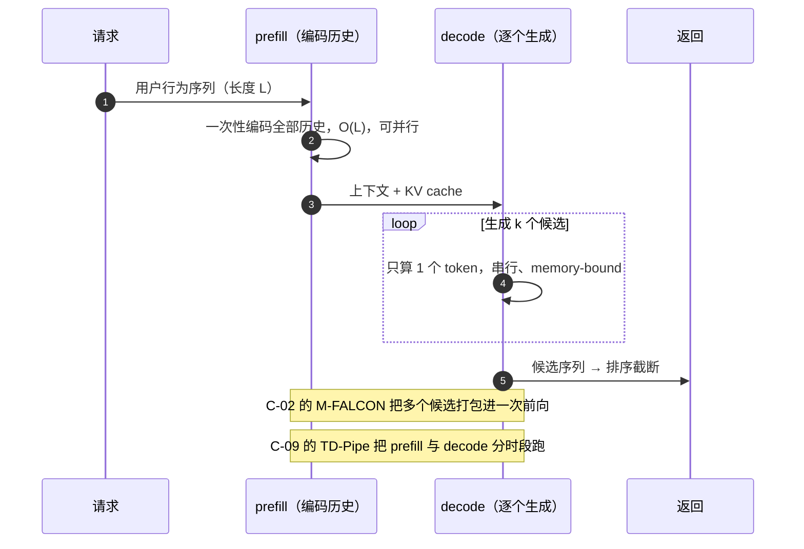

# 系统骨架：一次迭代、一次请求

## 为什么先看这张图

前 13 章按层切：嵌入表一层、通信一层、存储一层、模型一层。好处是每章能讲透一个机制；代价是读完可能仍然答不上来一个最朴素的问题：

> 一次训练迭代里，时间花在哪几段？线上的一次请求，又和训练差在哪？

这页补的就是这个骨架。后面每一章都是在这条时间线上改动某一段：切分改第 3 段从哪取数，缓存改第 4 段能否命中，压缩改第 3、4 段搬多少，流水并行改第 5 段怎么排。

下面先看交互顺序（谁等谁），再看时间占比（各段多长），最后是生成式模型在推理侧多出来的两段。它们用的是[贯穿算例](running-example)里的同一个模型。

## 训练：一个迭代的六个时段

⚠️ 这是串行基线。真实系统不会按顺序走：`A-10`（Bagpipe）、`A-11`（ScratchPipe）会把下一批的查表与这一批的稠密计算重叠。图先画串行，是因为只有看清串行里各段的位置，才知道哪里能重叠。

### 同一迭代的时间轴

按第 3 章的三堵墙估算（三个假设：IB 400 Gbps 跑到 50 GB/s、随机访存有效带宽 450 GB/s、算力利用率 30%），各段的相对耗时是这样：

1 · 装载 batch与计算重叠

2 · 展开 / 去重主机 CPU

3 · 路由 all-to-all≈ 10.5 ms

4 · gather / 池化≈ 2.3 ms

5 · 稠密前后向≈ 6.5 ms

6 · 回传 / 更新≈ 10.5 + 2.3 ms

第 3–6 行的条形按第 3 章的单项估算等比绘制；第 1、2 行没有对应估算，长度只是示意。<strong>全图是示意值不是实测</strong>；回传与更新按与读路径对称估算。第 3 章只算了读路径，所以它给出的"通信占 55%"是<strong>低估</strong>。

### 六段分别在干什么

| 时段 | 在做什么 | 这一段贵在哪 | 对应章节 |
|---|---|---|---|
| 1 · 装载 batch | CPU 读样本、拼张量、拷到 GPU | 通常能与计算重叠，不占关键路径 | — |
| 2 · 展开 / 去重 | 819 万次查询去重成约 205 万唯一行 | 索引本身也是要传输的数据 | [2](02-embedding-table) · [6](06-communication) |
| 3 · 路由 all-to-all | 按行所属分片把查询发出去 | 跨机带宽；分片越散越贵 | [5](05-sharding-taxonomy) · [6](06-communication) |
| 4 · gather / 池化 | 每片取行，按特征域 pool | 随机访存的带宽效率只有 10–50% | [2](02-embedding-table) · [7](07-storage-hierarchy) · [9](09-compression) |
| 5 · 稠密前后向 | 特征交互 + MLP，算梯度 | 算力；模型变深后这一格会变厚 | [3](03-bandwidth-wall) · [10](10-model-evolution) |
| 6 · 回传 / 更新 | 梯度 all-to-all + row-wise update | 通信再来一遍，而且写也贵 | [4](04-data-parallel-limits) · [6](06-communication) · [8](08-caching-consistency) |

## 从时间轴上看出的三件事

### 一、通信走两遍，不是一遍

第 3 段和第 6 段都是 all-to-all。第 3 章算"通信占 55%"时只算了读；把反向的梯度回传算上，通信只会更重。这就是为什么 `A-10` 报告"嵌入访问 + 同步约占迭代时间 75%"——它算的是完整一轮。

推论：任何只优化前向通信的方案，收益上限大约是通信开销的一半。压缩（第 9 章）有效，是因为它同时作用在去程和回程。

### 二、串行是基线，重叠才是优化

如果六段严格串行，总时间就是各段相加。真实系统让下一批的第 3、4 段与这一批的第 5 段同时跑，总时间向 `max(通信, 计算)` 靠，而不是两者之和。

`A-10` / `A-11` 的"预知下一批"（第 8 章）就是为此：训练数据固定，就能提前知道下一批要查哪些行，把查表提前。代价是只适用于离线训练，在线学习时"下一批"还不存在。

### 三、51 ms 是预算，不是这六段之和

算例里的 51 ms 由 `A-10` 的吞吐（16 trainer、320K 样本/秒）折算，是集群吞吐视角；上面几段是单 worker 顺序执行的示意。两者不是同一把尺，不能相加对账。

它的用途是给出一个上限感：不管优化哪一段，最后都要回答"从 51 ms 里抢回了多少，代价落在哪一段"。

## 推理：一次请求的时段

训练是大 batch、可排队、要吞吐；推理是小 batch、有 SLO、要尾延迟。形状不同，骨架也不同。

### 推理的五段

| 时段 | 在做什么 | 为什么和训练不同 | 对应章节 |
|---|---|---|---|
| 1 · 特征获取 | 取用户历史与候选集 | 训练时特征随 batch 到；在线要现查 | [8](08-caching-consistency) · [10](10-model-evolution) |
| 2 · 向量查找 | 候选 ID → 嵌入向量 | 训练查 819 万个；推理只查几百到几千个，但不能等 | [5](05-sharding-taxonomy) · [7](07-storage-hierarchy) |
| 3 · 命中 / 回源 | 热点留在 HBM/DRAM，冷的去远端或 SSD | 命中率决定 P99；训练能预取，推理不能 | [7](07-storage-hierarchy) · [8](08-caching-consistency) |
| 4 · 打分 | DLRM 的 MLP，或生成式的注意力 | 训练关心梯度；推理只有前向 | [10](10-model-evolution) · [11](11-pipeline-parallel) |
| 5 · 返回 top-k | 排序、截断、下发 | 训练根本没有这一步 | — |

推理的预算不是平均值，是最慢的 1%。训练卡一卡，下一轮补上就行；在线请求卡一卡，就是一次超时。所以推理侧的技术（`B-01` 的缓存与低精度）和训练侧（`B-09` 的层级存储、必须无损）方向相反，原因在目标函数，不在技术本身。

### 生成式模型：推理多了一段

DLRM 推理是"查表 → MLP → top-k"一次前向。生成式推荐（`C-02` HSTU 一类）的推理拆成两段：

这两段的性质完全不同：prefill 是算力受限、可并行；decode 是访存受限、串行。所以 `C-09` 才主张把它们在时间上分开部署（时分），而不是混在一批里。⚠️ `C-09` 原文明确说目标是无 SLO 的离线场景，不能直接用于在线 serving。

训练没有 prefill/decode 之分，这是推理独有的结构，不能套到训练上。

## 骨架怎么挂上 13 章

| 你在图上看到的现象 | 优化动作 | 去哪一章 |
|---|---|---|
| 索引又碎又多 | 去重策略、消息合并、压缩 | [6](06-communication) · [9](09-compression) |
| 跨机 all-to-all 太贵 | 分片、拓扑感知、融合通信 | [5](05-sharding-taxonomy) · [6](06-communication) |
| gather 打不满带宽 | 缓存、分层存储、量化 | [7](07-storage-hierarchy) · [8](08-caching-consistency) · [9](09-compression) |
| 稠密部分算力不够 | 模型结构、并行策略 | [3](03-bandwidth-wall) · [10](10-model-evolution) · [11](11-pipeline-parallel) |
| 梯度与更新太慢 | 同步 / 异步、稀疏更新 | [4](04-data-parallel-limits) · [8](08-caching-consistency) |
| 推理尾延迟高 | 提高命中率、分层、打包候选 | [7](07-storage-hierarchy) · [10](10-model-evolution) |

用法：每章开头先回想它在改这张图的哪一段；读完再回来确认两件事：那段是否真的变短，代价落在哪一段。

## 代价与边界

- 这张图是 DLRM 系（大嵌入 + 浅稠密）的骨架。第 10 章之后模型变深，第 5 段会变厚，整个比例要重画。
- 时间轴上的毫秒数全是按第 3 章假设折算的示意值，不是任何论文的实测，也不能拿去做容量规划。
- "训练六段 / 推理五段"是教学切分，不是框架的模块划分。真实系统里相邻段经常被融合（`A-15` FusedRec 就是把通信融进算子），融合之后段数会变少。
- 推理侧本教程没有给绝对延迟数字：`B-01` 报的是相对收益（最多省 94% 内存），没有可比的延迟基线。任何"推理快多少倍"的跨论文比较都不可信。

一句话概括这个骨架：训练是「展开 → 路由 → 取数 → 计算 → 回传 → 更新」，通信走两遍、可与计算重叠；推理是「取特征 → 查向量（命中或回源）→ 打分 → 返回」，DLRM 一次前向，生成式多一段 prefill + decode。

后面 13 章，全部是在这张图上改某一段。

骨架切分与时间轴是我按 DLRM 训练流程和第 3 章的估算构造的教学模型，不是任何单篇论文的图。段内机制与数字的来源：`A-10` Bagpipe（预知下一批、嵌入访问+同步占 75%）、`A-11` ScratchPipe（离线训练才可预取）、`A-15` FusedRec（通信与算子融合）、`C-02` HSTU（M-FALCON 打包候选）、`C-09` TD-Pipe（prefill / decode 分时，无 SLO 离线场景）、`B-01` EVStore（推理侧缓存，内存最多省 94%）、`B-09` HPS（训练侧必须无损）。

← 回到 [课程地图](index) ｜ 继续读 → [贯穿全教程的算例](running-example)
